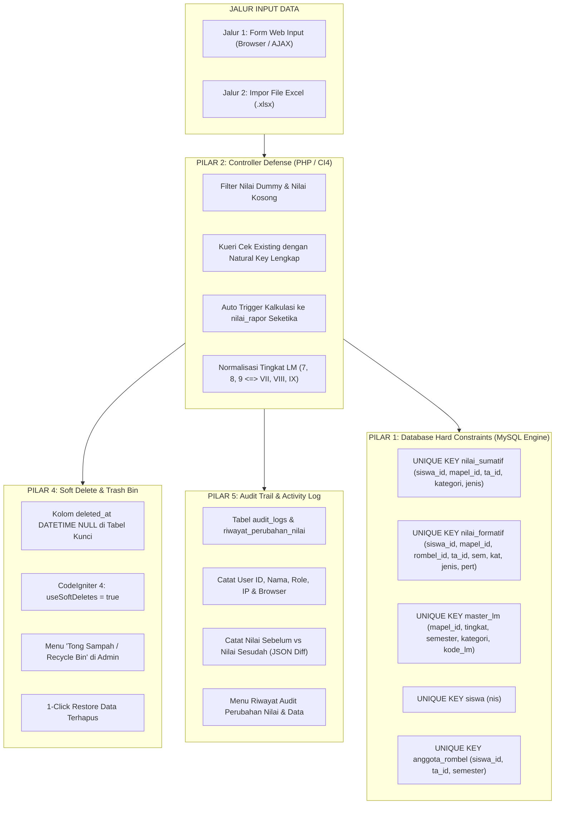

# MASTER PLAN PERBAIKAN INTEGRITAS DATA: INPUT FORM WEB & IMPOR EXCEL
## Arsitektur Anti-Duplikasi, Anti-Timpa, Soft Delete & Audit Trail (Enterprise Zero-Corrupt Data Policy)

**Aplikasi:** e-Rapor SMP Swasta IT Ad Durrah  
**Cakupan Jalur:**  
1. **Jalur Form Input Web (Layar Input Guru & Admin via Browser/AJAX)**  
2. **Jalur Impor Berkas Excel (.xlsx)**  
**Target Modul:**  
- **Modul Nilai Formatif & Nilai Sumatif (STS/SAS)**  
- **Modul Lingkup Materi (Master LM Tingkat VII, VIII, IX)**  
- **Modul Data Siswa & Anggota Rombel**  
- **Modul Keamanan: Soft Delete (Recycle Bin) & Audit Trail Logging**  
**Dokumen Referensi:** [`03_PROGRESS_DAN_LOG_EKSEKUSI_REPAIR.md`](file:///d:/laragon/htdocs/erapoteasy/docs/dbrepair/03_PROGRESS_DAN_LOG_EKSEKUSI_REPAIR.md) & [`analisa_dan_plan_import_siswa.md`](file:///d:/laragon/htdocs/erapoteasy/docs/analisa_dan_plan_import_siswa.md)  
**Tanggal Penyusunan:** 28 Oktober 2026

---

## 1. MENGAPA JALUR FORM INPUT WEB JUGA HARUS DIPERBAIKI?

Audit teknis membuktikan bahwa kerusakan data di database **BUKAN HANYA berasal dari impor Excel, melainkan JUSTRU BANYAK DIPICU OLEH FORM INPUT WEB**:

```
                       ┌─────────────────────────┐
                       │   Form Input Web Guru   │──┐
                       └─────────────────────────┘  │
                                                    ▼
                       ┌─────────────────────────┐  [Controller Layer]
                       │   Impor Berkas Excel    │──► (Upsert Logic + Audit Log)
                       └─────────────────────────┘  │
                                                    ▼
                                            [MySQL Database]
                                            (UNIQUE CONSTRAINT + SOFT DELETE)
```

### Bukti Konkret Kerusakan dari Form Input Web:
1. **Kasus 55 Nilai Dummy `1.00` pada Nilai Sumatif:**
   - Terjadi pada layar form web guru [`NilaiSumatifController::saveBulk`](file:///d:/laragon/htdocs/erapoteasy/backend/app/Controllers/GuruMapel/NilaiSumatifController.php#L136).
   - Saat guru membuka form penilaian sumatif lalu menekan tombol *"Simpan Draft"*, input teks untuk siswa yang belum dinilai secara otomatis mengirimkan nilai default sistem (angka `1.00`).
   - Karena controller tidak mengecek kelengkapan filter `kategori` (`Tengah Semester` vs `Akhir Semester`), sistem meng-insert baris baru bernilai `1.00` yang akhirnya bertumpuk dengan nilai asli siswa.
2. **Kasus Nilai Rapor Cetak Kosong (`- -`):**
   - Saat guru menginput nilai formatif via form web ([`saveNilai`](file:///d:/laragon/htdocs/erapoteasy/backend/app/Controllers/GuruMapel/NilaiFormatifController.php#L279)) atau form sumatif ([`saveBulk`](file:///d:/laragon/htdocs/erapoteasy/backend/app/Controllers/GuruMapel/NilaiSumatifController.php#L136)), sistem **hanya menyimpan ke tabel mentah** tanpa otomatis mengkalkulasi ke tabel `nilai_rapor`.
   - Guru harus mengingat untuk membuka menu terpisah untuk sinkronisasi rapor. Jika terlewat, rapor cetak siswa tetap kosong.
3. **Kasus Hilangnya 24 Siswa (Hard Delete Tanpa Jejak):**
   - Di sistem lama, tombol delete langsung menjalankan query `DELETE FROM siswa WHERE id = ...`. Tidak ada mekanisme penampungan sementara (*soft delete*) dan tidak ada log siapa yang menghapus.
   - 24 siswa terhapus secara permanen dan harus dipulihkan secara manual dari backup.

---

## 2. LIMA PILAR PERLINDUNGAN MENYELURUH (COMPREHENSIVE ENTERPRISE DEFENSE)



---

## 3. RANCANGAN DETAIL PERBAIKAN: FORM WEB & IMPOR EXCEL

### A. MODUL NILAI SUMATIF (STS & SAS)

| Aspek | Masalah Saat Ini | Solusi Baru (Form Web & Excel) |
|---|---|---|
| **Pengecekan Data Eksis** | `where('siswa_id')->where('mapel_id')->where('ta_id')->where('jenis_sumatif')` (Kategori 'Tengah'/'Akhir' tertinggal). | Wajib menyertakan `kategori` (`where('kategori', $kategori)`). Kunci unik 5 kolom. |
| **Penanganan Nilai Kosong / Belum Diisi** | Nilai kosong dikirim sebagai `1.00` atau `""` lalu di-insert ke DB. | Jika input kosong/null/strip (`-`), data dilewati (*skip*). Jangan pernah menyimpan nilai dummy `1.00`. |
| **Sinkronisasi ke Nilai Rapor** | Harus diproses manual via menu lain. | **Otomatis dihitung seketika** di akhir eksekusi `saveBulk()` (Form Web) maupun `importExcel()` (Excel). |
| **Database Constraint** | Belum ada Unique Index. | Pasang `uq_sumatif_siswa_mapel_ta_kat_jenis` di MySQL. |

```sql
-- DDL Constraint Mutlak Nilai Sumatif
ALTER TABLE `nilai_sumatif` 
ADD UNIQUE KEY `uq_sumatif_siswa_mapel_ta_kat_jenis` (`siswa_id`, `mapel_id`, `tahun_ajaran_id`, `kategori`, `jenis_sumatif`);
```

---

### B. MODUL NILAI FORMATIF

| Aspek | Masalah Saat Ini | Solusi Baru (Form Web & Excel) |
|---|---|---|
| **Multi-Click / Double Submit Form** | Guru mengklik tombol "Simpan Nilai" berkali-kali saat koneksi lambat, memicu insert ganda. | 1. Frontend: Tombol langsung *disabled* dengan spinner.<br>2. Backend: Transaction + Locking.<br>3. MySQL: Unique Constraint. |
| **Deskripsi Capaian LM** | Jika deskripsi form kosong, teks predikat terputus. | Auto-generate deskripsi dari Master LM aktif jika guru tidak mengetik manual. |
| **Database Constraint** | Belum ada Unique Index. | Pasang `uq_formatif_lengkap` di MySQL. |

```sql
-- DDL Constraint Mutlak Nilai Formatif
ALTER TABLE `nilai_formatif` 
ADD UNIQUE KEY `uq_formatif_lengkap` (`siswa_id`, `mapel_id`, `rombel_id`, `tahun_ajaran_id`, `semester`, `kategori`, `jenis_penilaian`, `pertemuan`);
```

---

### C. MODUL LINGKUP MATERI (MASTER LM)

| Aspek | Masalah Saat Ini | Solusi Baru (Form Web & Excel) |
|---|---|---|
| **Form Tambah/Edit Web** | Pengecekan ada tapi jika guru menginput tingkat angka `7` dan guru lain menginput `VII`, keduanya tersimpan sebagai dua materi berbeda. | Helper `normalisasiTingkat()`: Setiap input tingkat diubah ke standar seragam sebelum query cek & insert. |
| **Impor Excel LM** | Sering menggunakan logika hapus data lama (`DELETE/TRUNCATE`) per file, sehingga mapel lain ikut terhapus. | Menggunakan mode **Upsert Murni**: Jika LM sudah ada, update teksnya. Jika belum, tambah baru. Dilarang keras melakukan DELETE massal. |
| **Database Constraint** | Belum ada Unique Index. | Pasang `uq_master_lm_unique` di MySQL. |

```sql
-- DDL Constraint Mutlak Master LM
ALTER TABLE `master_lm`
ADD UNIQUE KEY `uq_master_lm_unique` (`mapel_id`, `tingkat`, `semester`, `kategori`, `kode_lm`);
```

---

### D. MODUL DATA SISWA & ANGGOTA ROMBEL

| Aspek | Masalah Saat Ini | Solusi Baru (Form Web & Excel) |
|---|---|---|
| **Form Tambah Siswa Manual** | Form tidak memvalidasi keunikan NIS terhadap data yang sudah ada, berisiko bentrok nomor induk. | Validasi form wajib memeriksa keunikan NIS (`is_unique[siswa.nis]`) sebelum eksekusi simpan. |
| **Penempatan Rombel Siswa** | Siswa bisa terdaftar di dua kelas pada semester yang sama (142 kasus kemarin). | Kunci unik `uq_siswa_ta_smt (siswa_id, tahun_ajaran_id, semester)`. Jika dipindah kelas via form web, sistem melakukan **UPDATE** `rombel_id`, bukan insert baris baru. |
| **Database Constraint** | Kolom `nis` di tabel `siswa` belum UNIQUE. | Pasang `uq_siswa_nis` di MySQL. |

```sql
-- DDL Constraint Mutlak Siswa
ALTER TABLE `siswa`
ADD UNIQUE KEY `uq_siswa_nis` (`nis`);
```

---

## 4. PILAR 4: FITUR SOFT DELETE & TRASH (ANTI-ASAL DELETE)

### A. Masalah Fatal Saat Ini:
Saat admin atau staf mengklik tombol "Hapus" pada siswa, kelas, nilai, atau master LM, aplikasi langsung mengeksekusi perintah SQL `DELETE FROM table WHERE id = ?`.
Data musnah seketika dan tidak bisa dikembalikan kecuali me-restore database utuh dari backup.

### B. Solusi Soft Delete (Menggunakan Fitur Native CodeIgniter 4):
1. **Penambahan Kolom `deleted_at` di Database:**
```sql
ALTER TABLE `siswa` ADD COLUMN `deleted_at` DATETIME NULL DEFAULT NULL AFTER `foto_siswa`;
ALTER TABLE `anggota_rombel` ADD COLUMN `deleted_at` DATETIME NULL DEFAULT NULL AFTER `created_at`;
ALTER TABLE `master_lm` ADD COLUMN `deleted_at` DATETIME NULL DEFAULT NULL AFTER `updated_at`;
ALTER TABLE `nilai_formatif` ADD COLUMN `deleted_at` DATETIME NULL DEFAULT NULL AFTER `updated_at`;
ALTER TABLE `nilai_sumatif` ADD COLUMN `deleted_at` DATETIME NULL DEFAULT NULL AFTER `updated_at`;
ALTER TABLE `nilai_rapor` ADD COLUMN `deleted_at` DATETIME NULL DEFAULT NULL AFTER `updated_at`;
```

2. **Aktivasi di Model CodeIgniter 4:**
Pada `SiswaModel`, `MasterLmModel`, `NilaiSumatifModel`, dsb:
```php
protected $useSoftDeletes = true;
protected $deletedField   = 'deleted_at';
```
- Saat tombol "Hapus" diklik (`$model->delete($id)`), CI4 secara otomatis hanya mengisi `deleted_at = NOW()`.
- Seluruh fungsi pencarian (`findAll()`, `find()`, cetak rapor) otomatis menyaring dan **hanya mengambil data aktif** (`WHERE deleted_at IS NULL`).

3. **Fitur "Tong Sampah / Recycle Bin" di Menu Admin:**
- Menyediakan halaman khusus **"Data Terhapus / Trash"** untuk Admin.
- Jika ada siswa atau nilai yang tidak sengaja terhapus oleh staf, Admin cukup mengklik tombol **"Restore (Pulihkan)"** &rarr; data kembali aktif 100% tanpa perlu panggil teknisi/restore SQL.
- Opsi **"Hapus Permanen (Force Delete)"** hanya diberikan kepada Super Admin dengan proteksi kata sandi konfirmasi.

---

## 5. PILAR 5: AUDIT TRAIL & LOG AKTIVITAS (PELACAK JEJAK PENGUBAH DATA)

### A. Masalah Saat Ini:
Tabel `audit_logs` dan `riwayat_perubahan_nilai` sudah ada di database, namun **tidak pernah dipanggil/difungsikan oleh controller**. Jika nilai siswa berubah dari 80 ke 90, atau ada data terhapus, admin tidak bisa mengetahui:
- Siapa pelakunya (User ID, Nama Guru, Role)
- Kapan perubahan dilakukan (Timestamp)
- Dari perangkat/IP mana (IP Address, User Agent)
- Nilai asli sebelumnya apa, dan diubah menjadi apa (*Before vs After*)

### B. Implementasi Audit Logging Terpadu:
Membuat Helper/Service `AuditLogService` yang otomatis mencatat setiap operasi `INSERT`, `UPDATE`, `DELETE`, dan `RESTORE`:

1. **Struktur Skema Penyimpanan:**
```sql
ALTER TABLE `audit_logs` 
MODIFY COLUMN `action` ENUM('LOGIN', 'LOGOUT', 'CREATE', 'UPDATE', 'DELETE', 'RESTORE', 'IMPORT') NOT NULL,
ADD COLUMN `role` VARCHAR(50) NULL AFTER `user_id`,
ADD COLUMN `tabel` VARCHAR(50) NULL AFTER `role`,
ADD COLUMN `record_id` INT NULL AFTER `tabel`,
ADD COLUMN `old_data` LONGTEXT NULL AFTER `description`,
ADD COLUMN `new_data` LONGTEXT NULL AFTER `old_data`,
ADD COLUMN `user_agent` TEXT NULL AFTER `ip_address`;
```

2. **Contoh Hasil Catatan yang Terekam Otomatis:**
```json
{
  "user": "Ustadz Septian Syahputra (Guru Mapel)",
  "action": "UPDATE",
  "tabel": "nilai_sumatif",
  "record_id": 1420,
  "keterangan": "Mengubah nilai STS Bahasa Arab untuk siswa Adabi Limansyah (Topaz)",
  "old_data": {"nilai": "55.00", "status": "draft"},
  "new_data": {"nilai": "75.00", "status": "terkunci"},
  "ip_address": "192.168.1.45",
  "waktu": "2026-10-28 08:30:15"
}
```

3. **Menu Tampilan UI di Admin:**
- **Menu: "Log Audit Aktivitas Sistem"**: Memantau seluruh aksi login, import, dan penghapusan data.
- **Menu: "Riwayat Perubahan Nilai"**: Memantau setiap guru yang mengedit nilai siswa, lengkap dengan perbandingan nilai lama vs nilai baru.

---

## 6. JAMINAN KEAMANAN TERHADAP DATA LAMA

Bagaimana memastikan pembaruan ini tidak menghapus data yang sah atau merusak data lama?

1. **Prinsip "Non-Destructive":**
   - Tidak ada operasi `TRUNCATE` atau `DROP TABLE`.
   - Skrip hanya menambahkan kolom `deleted_at`, indeks pengaman (*Index Constraint*), dan tabel audit.
2. **Pembersihan Prasyarat (Pre-requisite Sanitization):**
   - Karena kita telah membersihkan 63 sumatif ganda, 142 rombel ganda, dan menyelaraskan seluruh NIS kemarin, **seluruh tabel saat ini sudah 100% bersih dan siap menerima UNIQUE KEY tanpa ada error duplicate key**.
3. **Transparansi Feedback Pengguna:**
   - Baik di form web maupun impor Excel, jika ada kesalahan input (misal NIS kembar atau nilai di luar rentang 0-100), sistem memberikan pesan error yang ramah dan jelas, bukan *Fatal Error 500* layar putih.

---

## 7. RENCANA TAHAPAN IMPLEMENTASI LENGKAP (ROADMAP KERJA)

| No | Modul | Sasaran Form Web & Sistem | Sasaran Impor Excel | Target Waktu |
|---|---|---|---|:---:|
| **1** | **Database DDL (Constraint & Soft Delete)** | Tambahkan `UNIQUE KEY` pada `nilai_sumatif`, `nilai_formatif`, `master_lm`, `siswa(nis)`. Tambahkan kolom `deleted_at` di 6 tabel kunci. | Fondasi keamanan mutlak di level mesin MySQL. | 1 Hari |
| **2** | **Soft Delete & Trash Bin (CI4 Models)** | Aktifkan `$useSoftDeletes = true` pada model Siswa, LM, Nilai. Buat halaman Recycle Bin di Admin. | Fitur pulihkan data terhapus dengan 1 klik. | 1 Hari |
| **3** | **Audit Trail Logging Engine** | Implementasi `AuditLogService` untuk merekam siapa yang menambah, mengubah, dan menghapus data (before vs after). | Rekam riwayat import file dan user pengunggah. | 1 Hari |
| **4** | **Nilai Sumatif & Formatif** | Refactor `saveBulk` & `saveNilai`: Filter dummy 1.00, proteksi nilai kosong, auto-hitung `nilai_rapor`. | Refactor `importExcel`: Proteksi sel kosong, auto-hitung `nilai_rapor`. | 1-2 Hari |
| **5** | **Master LM** | Form web: Helper normalisasi tingkat Romawi/Angka sebelum simpan. | Impor LM: Mode Upsert murni tanpa delete data mapel lain. | 1 Hari |
| **6** | **Data Siswa & Rombel** | Form web: Validasi keunikan NIS sebelum simpan, update kelas aman. | Impor Siswa: Dukungan dual file (Dapodik 66 kolom & Template 18 kolom). | 1 Hari |
| **7** | **UAT & Simulasi Menyeluruh** | Pengujian input form, uji hapus-restore recycle bin, dan verifikasi catatan audit log. | Uji coba stress test impor ganda berulang kali. | 1 Hari |

---

## 8. STATUS & KESIAPAN EKSEKUSI
- [x] Database lokal saat ini telah bersih dari data ganda (0 duplikat).
- [x] Master Plan telah mencakup **Jalur Form Web** dan **Jalur Impor Excel**.
- [x] Master Plan telah mengintegrasikan **Fitur Soft Delete (Tong Sampah)** dan **Audit Trail Log**.
- [ ] Siap untuk dieksekusi bertahap sesuai instruksi Anda.
